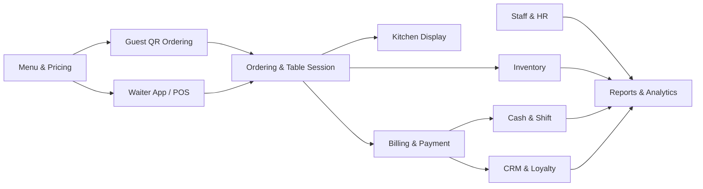

# Restaurant Management System – Business Requirements

| Item | Value |
|---|---|
| Document | Business Requirements (system level) |
| Version | 1.0 – Draft |
| Date | 2026-10-27 |
| Related | [QR Table Ordering – Functional Requirements](qr-table-ordering-requirements.md) (detailed spec of module M2) |

## 0. Overview

- **Product:** an end-to-end platform for restaurant operations: front of house (ordering, serving, payment), back of house (kitchen, inventory, staff), and management (reports, finance, multiple branches).
- **Product model:** multi-tenant SaaS. One platform serves many independent restaurant businesses (tenants); each tenant may have one or more branches.
- **MVP scope:** à la carte, **table-service** restaurants: guests dine in, order in **multiple rounds**, and **pay at the end** of the meal.
- Key terms are defined in the [Glossary](#12-glossary).

## 1. Business Context

### 1.1 Problems

| Pain point | Impact |
|---|---|
| Orders taken on paper | Slow service, wrong orders, lost tickets |
| No real-time stock visibility | Items run out during service; waste and theft go unnoticed |
| Cash handling and shift closing done by hand | Revenue leakage, reconciliation errors |
| Staff scheduling and timekeeping on paper or in Excel | Over- or understaffing, payroll disputes |
| Data scattered across tools | Owners cannot make data-driven decisions, especially across branches |

### 1.2 Goals

- **Restaurant goals:** faster service, higher table turnover and bill value, lower food cost and leakage, accurate financials, and central control as the business grows.
- **Platform goals (SaaS):** fast self-service onboarding, recurring subscription revenue, a single configurable codebase, and low support cost.

### 1.3 Service Model (MVP Baseline)

| Aspect | Rule |
|---|---|
| Service style | Table service; waiters bring dishes to the table |
| Ordering | At the table: the guest scans the table's QR code, or a waiter enters the order |
| Table session | Required; each occupied table has one open session that holds all its orders |
| Order rhythm | **Multiple rounds** per session (e.g. drinks → starters → mains → dessert) |
| Payment timing | **Pay later**, once, at the end of the meal (at the counter or at the table) |
| Typical modifiers | Doneness, spice level, portion size, side dishes, free-text notes |
| Station routing | Kitchen stations (e.g. hot, cold, grill) and bar |

**Out of MVP scope:** café/counter service, pay-first flow, pickup numbers, takeaway, delivery, buffet, per-person pricing (hotpot/BBQ), and time-based billing. The core design must allow these to be added later through configuration, without a redesign.

## 2. Stakeholders & Roles

| Role | Main needs |
|---|---|
| Guest | Order quickly at the table, add more rounds, track dishes, pay easily |
| Waiter | Manage tables, confirm and enter orders, serve, handle guest requests |
| Cashier | Prepare bills, take payments, close the shift |
| Kitchen / Bar staff | Receive clear tickets, manage preparation and sold-out items |
| Storekeeper | Receive goods, track stock, run stock takes |
| Branch Manager | Run daily operations, schedule staff, review branch reports |
| Owner | See the whole business: sales, finance, menu, and pricing |
| Tenant Admin | Manage users, permissions, devices, and settings for their own business |
| Platform Admin / Support (SaaS provider) | Manage tenants, subscriptions, support, and platform health |

## 3. Solution Overview

### 3.1 Applications

| Application | Users | Platform |
|---|---|---|
| Guest Ordering (QR) | Guests | Mobile web (PWA) |
| POS | Cashiers, waiters | Tablet / PC browser |
| Waiter App | Waiters | Phone / tablet browser |
| Kitchen Display System (KDS) | Kitchen and bar staff | Tablet / TV browser |
| Back Office | Managers, storekeepers, owners, tenant admins | Web |
| Owner Dashboard | Owners | Mobile web |
| Platform Admin Portal | SaaS provider | Web |

### 3.2 Module Context

## 4. Functional Modules

Each module is tagged with its delivery phase (see §9).

### M1. Table & Floor Management — Phase 1
- Set up zones, tables (with capacity), and a floor plan for each branch.
- Show table status in real time: Empty, Occupied, Waiting for food, Bill requested, Cleaning (Reserved is added with M10).
- Open and close table sessions; move, merge, and split tables; transfer items between tables.

### M2. Ordering (QR + Waiter) — Phase 1
- **QR self-ordering** at the table (detailed in the [QR ordering spec](qr-table-ordering-requirements.md)).
- **Every QR order must be confirmed by a waiter** before it is sent to the kitchen. This prevents mistaken and prank orders.
- Waiters can enter orders in the Waiter App or POS for guests who do not use QR; these orders go straight to the kitchen.
- **Multiple rounds per session**; every round is added to the same table bill.
- Item modifiers and notes; course control with hold & fire (e.g. hold mains until starters are finished).
- Cancel or void items with a mandatory reason; what is allowed depends on the item's kitchen status.
- Guest requests: call a waiter, request the bill.

### M3. Kitchen Display System (KDS) — Phase 1
- Route items to the right station (kitchen stations, bar); print tickets as a fallback.
- Each round appears as a new ticket, labelled with the table and round number.
- Ticket timers, rush flag, and item status (Preparing → Ready → Served).
- Mark an item as sold out in one tap; the QR menu and POS update immediately.

### M4. Menu & Pricing — Phase 1
- Categories, items, photos, modifiers, set menus, allergens, and names in several languages.
- Menus and prices by time of day (e.g. lunch, dinner, happy hour).
- Item availability by time of day.
- Recipe (bill of materials) for each item, used by Inventory from Phase 2.

### M5. POS, Billing & Payment — Phase 1
- One running bill per table session, accumulating all rounds.
- Bill calculation: service charge, VAT, discounts, vouchers, rounding.
- Split the bill (equally, by item, or by person); merge bills; partial payments; tips.
- Print a pre-bill (with a VietQR code) for the guest to check before paying.
- Payment methods are introduced in phases (see §11.2). In the MVP: cash, bank transfer via VietQR, and card payments on the restaurant's existing card terminal, each confirmed by the cashier.
- E-invoices under Vietnamese regulations (Decree 123/2020 as amended by Decree 70/2025; Circular 78/2021). MVP: capture the buyer's invoice details and export them; provider integration follows in Phase 2.
- Refunds and voids require manager authorization.

### M6. Cash & Shift Management — Phase 1
- Open a shift with an opening float; record cash in and cash out (petty cash).
- **Shift and end-of-day closing:** compare expected and actual amounts for each payment method and report the variance.
- Hand over between cashiers; warn about tables still open when a shift is closed.

### M7. Inventory & Purchasing — Phase 2
- Ingredient master data with units of measure and conversions (e.g. kg ↔ g).
- Deduct stock automatically from sales, based on recipes.
- Suppliers, purchase orders, goods receipts, and stock transfers between branches.
- Stock takes with variance reports; waste and spoilage records.
- Low-stock alerts and reorder points; expiry tracking (FIFO/FEFO).
- Food cost report (theoretical vs. actual).

### M8. Staff & HR — Phase 2
- Employee profiles, roles, and permissions for each branch.
- Shift schedules and shift-swap requests.
- Timekeeping: clock in/out by app, PIN, or QR code, verified by GPS or Wi-Fi.
- Payroll inputs: hours worked, overtime, and tip or service-charge sharing.
- Staff performance (sales per waiter, tables served).

### M9. CRM, Loyalty & Promotions — Phase 3
- Guest profile identified by phone number or Zalo account; visit and spending history.
- Loyalty points, membership tiers, birthday rewards.
- **Promotion engine:** percentage or fixed discounts, buy X get Y, set prices, happy hour, voucher codes, with conditions (time, branch, minimum spend).
- Feedback and ratings after the meal.

### M10. Reservations — Phase 3
- Table bookings (online and by phone), deposits, reminders, and no-show tracking.
- Pre-orders for groups and events.

### M11. Reports & Analytics — basic in Phase 1, advanced in Phase 2
- **Sales:** revenue by period, branch, item, category, waiter, and payment method.
- **Operations:** table turnover, average dining time, order-to-serve time, rounds per table, kitchen performance, voids and discounts.
- **Inventory:** stock value, food cost %, stock variance, waste.
- **Guests:** new vs. returning, top spenders, promotion effectiveness.
- Real-time owner dashboard; export to Excel/PDF; scheduled email reports.

### M12. Chain Management — Phase 4
- From Phase 1, a tenant can run several branches, each managed separately (its own menu, prices, and settings).
- Phase 4 adds central control: a shared menu, prices, and promotions pushed to branches (with local overrides), consolidated reports, and central purchasing.

### M13. System Administration — Phase 1
- Users, roles, and detailed permissions (e.g. who may void, discount, or refund).
- Device management: POS devices, printers, KDS screens, cash drawers.
- Settings: taxes, service charge, receipt templates, operating hours.
- **Audit log** of sensitive actions (voids, discounts, price changes, stock adjustments).
- Data export and automated backups.

### M14. SaaS Platform & Tenant Management — Phase 1 (automated billing in Phase 2)
- **Tenant structure:** `Tenant → Branch`. All data is isolated per tenant.
- **Self-service onboarding:** sign up (email or phone, verified by OTP) → setup wizard → apply the restaurant template (sample menu, modifiers, stations, receipt layout) → add tables and staff → connect the restaurant's own devices and printers → print the QR codes → go live.
- **Subscriptions:** one subscription per branch, a single plan, a 14-day free trial, monthly or yearly billing, renewal reminders, and the lifecycle in §11.3. Phase 1: subscription fees are paid by bank transfer and activated by the platform admin. Phase 2: online self-service payment and automatic renewal.
- **Feature flags:** turn on add-on modules (inventory, HR, loyalty) per tenant as they are released; also used for gradual rollouts.
- **Platform Admin Portal:** tenant list and status, subscription management, usage metrics, support access to a tenant's account (logged in the audit log), announcements.
- **Support:** in-app help center, support tickets, onboarding checklist.
- **Branding:** each tenant can show its logo and colours on its QR ordering page.

## 5. End-to-End Processes

1. **Order to cash:** guests seated → table session opened → round 1 ordered (QR or waiter) → QR order confirmed by a waiter → kitchen prepares → dishes served → further rounds (repeat) → bill requested → pre-bill → payment (split if needed) → e-invoice details captured if requested → session closed → table: Cleaning → Empty.
2. **Procure to stock (Phase 2):** low-stock alert → purchase order → goods receipt → stock updated → supplier payment recorded.
3. **Shift cycle:** open shift with float → sales → cash in/out → close shift → reconcile variance → daily report.
4. **Menu change:** manager updates an item or price → change published to QR menu and POS immediately; items already ordered keep their original price.
5. **Tenant lifecycle:** sign up → trial → onboarding with the template → subscribe → active → renew or cancel → data export → retention → deletion (see §11.3).

## 6. Core Data Entities

- **Platform:** `Tenant, Plan, Subscription, SubscriptionInvoice, FeatureFlag, PlatformUser`
- **Operations:** `Branch, Zone, Table, TableSession, MenuItem, Category, Modifier, Recipe, Ingredient, Order, OrderItem, Bill, Payment, Invoice, Shift, CashTransaction, Employee, Role, Schedule, Attendance, Guest, LoyaltyAccount, Promotion, Voucher, Supplier, PurchaseOrder, GoodsReceipt, StockMovement, StockTake, AuditLog`

Key relationships:
- `Table 1–n TableSession`, `TableSession 1–n Order` (one order per round), `Order 1–n OrderItem`.
- `TableSession 1–n Bill` (more than one bill when the bill is split), `Bill 1–n Payment`.

## 7. Integrations

| Area | Providers (examples) | Phase |
|---|---|---|
| Bank transfer QR | VietQR (Napas 247) | 1 |
| Thermal printers | Standard ESC/POS printers | 1 |
| Messaging | Email, Zalo OA/ZNS, SMS | 1 (email), 2 (Zalo, SMS) |
| Payment confirmation | PayOS, SePay, Casso | 2 |
| E-invoice | MISA meInvoice, VNPT, Viettel, BKAV (one provider first) | 2 |
| E-wallets and card terminals | MoMo, VNPay, ZaloPay, card terminals | 3 |
| Accounting | Excel export (1); MISA (3) | 1 / 3 |

## 8. Non-functional Requirements

| Category | Requirement |
|---|---|
| Offline operation | POS and Waiter App keep taking orders and cash payments when the internet drops, and sync once the connection returns |
| Real-time sync | Changes appear on POS, Waiter App, QR page, and KDS within 2 seconds |
| Performance | Handles peak-hour load across many tables, branches, and tenants at the same time |
| Availability | 99.9% during operating hours; automated daily backups |
| Security | Role-based access control, encryption in transit and at rest, no storage of card data, compliance with Vietnamese personal data protection rules (Decree 13/2023 and the Personal Data Protection Law) |
| Hosting | Data does **not** have to be hosted in Vietnam; a nearby cloud region (e.g. Singapore) is acceptable. Rules on transferring personal data abroad still apply |
| Device support | Browser-based apps for common Android and iOS phones and tablets and Windows/macOS PCs; standard ESC/POS printers over LAN, USB, or Bluetooth; no proprietary hardware |
| Usability | Tablet-first, few taps per task; new staff can learn it within one shift |
| Localization | Vietnamese and English, VND, Vietnamese tax rules |
| Multi-tenancy | Strict data isolation; one tenant can never see another tenant's data |
| Scalability | Scales horizontally; a heavy-load tenant must not slow down the others |
| Extensibility | Service behaviour is driven by configuration, so new service models (café, takeaway) can be added without a redesign |
| Releases | Zero-downtime deployment; backward-compatible APIs for devices that were offline during an update |

## 9. Roadmap

| Phase | Scope | Outcome |
|---|---|---|
| **1 – MVP** | M1, M2, M3, M4, M5, M6, M13, basic M11, M14 (self-service sign-up, setup wizard, template, trial, manually activated subscriptions) | Pilot restaurants run a branch end to end |
| **2 – Control & Cost** | M7, M8, advanced M11, e-invoice integration, automatic payment confirmation, online subscription payment | Restaurants control food and labour cost and meet invoicing rules; the platform bills automatically |
| **3 – Growth** | M9, M10, e-wallets and card terminal integration | Higher revenue and guest retention |
| **4 – Scale** | M12 central chain management, native owner app, AI forecasting, new service models (café, takeaway, delivery) | Support for chains and new segments |

## 10. Success Metrics (KPIs)

**Restaurant KPIs**
- Time from seating to first order; order-to-serve time.
- Table turnover rate and average dining time.
- Average bill value; rounds per table; share of orders placed via QR.
- Food cost % and stock variance (from Phase 2).
- Cash variance per shift.
- Labour cost as % of revenue (from Phase 2).
- Repeat-guest rate (from Phase 3).

**Platform KPIs**
- Active tenants and branches; trial-to-paid conversion rate.
- Time from sign-up to go-live.
- Monthly recurring revenue (MRR) and churn rate.
- Support tickets per tenant.

## 11. Assumptions, Risks & Decisions

### 11.1 Assumptions and Risks

**Assumptions**
- Target customers are small and mid-size à la carte, table-service restaurants in Vietnam, from independent restaurants to small chains.
- Each branch has stable Wi-Fi and its own devices (phones, tablets, PCs, printers); every table has a printed QR code.

**Risks and mitigations**

| Risk | Mitigation |
|---|---|
| Staff with limited digital skills | Simple UX, setup wizard, in-app help; waiters can always enter orders themselves |
| Restaurants give up during self-onboarding | Ready-made template, onboarding checklist, sample data |
| Wide range of customer devices and printers | Publish a list of tested devices; support only standard ESC/POS printers |
| Internet outages | Offline operation for POS and Waiter App |
| Errors in manually confirmed payments (MVP) | Each payment linked to a bill code; cashier confirmation step; shift reconciliation |
| E-invoice regulation: restaurants above a revenue threshold may have to issue e-invoices generated from the POS (Decree 70/2025) | **Confirm with a tax advisor before development starts**; bring the e-invoice integration forward if required |
| Requests for tenant-specific custom features | Decline custom code; handle needs through configuration and the roadmap |
| Strong competitors (e.g. KiotViet, iPOS, Sapo FnB) | Differentiate on QR ordering experience, easy self-onboarding, and simple pricing |

**Key decisions**

| # | Topic | Decision |
|---|---|---|
| D1 | Pricing | One subscription **per branch**; a chain pays for each branch, with a volume discount (see §11.3) |
| D2 | Onboarding | **Self-service:** restaurants sign up and set up their account themselves |
| D3 | Hardware | **Bring your own device:** restaurants use the devices they already have |
| D4 | QR order flow | **A waiter must confirm** every QR order before it reaches the kitchen |
| D5 | Payment and e-invoice | Start with **basic methods** and add integrations in later phases (see §11.2) |
| D6 | Data residency | Hosting in Vietnam is **not required** |
| D7 | Plans | **One plan** at launch with all MVP features and no free tier; add-on modules (inventory, HR, loyalty) are introduced in later phases |
| D8 | Trial | **14-day free trial** with full features; no payment details required |
| D9 | Account lifecycle | Grace period → read-only → locked → deleted after a fixed retention period; data export is always available (see §11.3) |

### 11.2 Payment & E-invoice Approach

| Phase | Payment | E-invoice |
|---|---|---|
| **1 – MVP** | Cash; **VietQR** bank transfer (dynamic QR with amount and bill code, paid into the restaurant's own bank account, shown on the pre-bill or the guest's phone); card payments on the existing terminal, recorded manually. The cashier confirms every payment. | Printed receipt; capture the buyer's invoice details (company name, tax code, address); export them for use in the restaurant's current e-invoice tool |
| **2** | Automatic confirmation of bank transfers through a bank-notification service (e.g. PayOS, SePay, Casso); the table closes automatically once paid | Integrate **one** e-invoice provider by API (e.g. MISA meInvoice, VNPT, Viettel), chosen by pilot demand |
| **3** | E-wallets (MoMo, VNPay, ZaloPay); integrated card terminals | More providers; POS invoices connected to the tax authority if required |

**Rationale:** VietQR is free, widely used, and needs neither a merchant contract nor extra hardware, which suits self-service onboarding and bring-your-own-device. Payment gateways and e-invoice providers each require a contract and a separate integration, so they follow later, based on pilot feedback.

### 11.3 Subscription & Data Lifecycle

**Pricing**
- Billing unit: **one branch**. A business with several branches has one tenant account and one subscription per branch, managed and invoiced together.
- Volume discount for chains (e.g. 3 or more branches); discount for yearly payment (e.g. two months free).
- **No limits** on tables, staff accounts, devices, or orders. This keeps pricing simple and suits bring-your-own-device.
- **No free tier:** a free tier increases support and infrastructure costs for a self-service product; the 14-day trial is enough for evaluation.
- Prices are in VND; the SaaS provider issues an e-invoice for every subscription payment.

**Subscription states**

| State | Entered when | Access |
|---|---|---|
| Trial | The tenant signs up | Full access for 14 days; reminders on days 7, 12, and 14 |
| Active | Payment is received | Full access |
| Grace period | The subscription or trial expires unpaid | Full access for **7 days**, with in-app, email, and Zalo reminders |
| Read-only | The grace period ends | **30 days** of viewing and exporting data; ordering, POS, and QR are disabled |
| Locked | The read-only period ends | No access; paying restores access |
| Deleted | **90 days** after locking, or earlier at the tenant's request | Data is permanently deleted; notices are sent 30 and 7 days in advance |

**Data rules**
- The tenant owns its data. A full export (menu, orders, bills, guests, reports) to Excel/CSV is available at any time, including in the Read-only state.
- Paying before deletion restores all data and settings.
- Restaurants are responsible for keeping their own accounting records as required by the Law on Accounting (at least 10 years for accounting documents); the platform reminds them to export before deletion.
- Guests' personal data is deleted or anonymized together with the tenant's data.

## 12. Glossary

| Term | Meaning |
|---|---|
| Tenant | A restaurant business with an account on the platform; owns one or more branches |
| Branch | One restaurant location; the billing unit |
| Table session | The period from seating guests at a table until their bill is paid; holds all their orders |
| Round | One batch of items ordered at the same time within a table session |
| Pre-bill | Printed or on-screen bill that guests check before paying |
| Hold & fire | Holding a course until staff release ("fire") it to the kitchen |
| POS | Point of sale: the app used to manage orders, bills, and payments |
| KDS | Kitchen Display System: screens that replace paper kitchen tickets |
| VietQR | Vietnam's standard bank-transfer QR code (Napas 247) |
| MVP | Minimum viable product: the first release (Phase 1) |
| SaaS | Software as a service: software rented by subscription and run in the cloud |
